  <picture>
    <source media="(prefers-color-scheme: dark)" srcset="Dark%20Header.svg" />
    <source media="(prefers-color-scheme: light)" srcset="Light%20Header.svg" />
    
  </picture>

  <strong>CLOUD ENGINEERING · DEVOPS ENGINEERING · PLATFORM ENGINEERING</strong>

  <a href="#about-me">About</a> &nbsp;·&nbsp;
  <a href="#engineering-work">Engineering Work</a> &nbsp;·&nbsp;
  <a href="#technology-toolkit">Technology Toolkit</a> &nbsp;·&nbsp;
  <a href="#engineering-principles">Engineering Principles</a> &nbsp;·&nbsp;
  <a href="#current-learning-direction">Learning Direction</a> &nbsp;·&nbsp;
  <a href="#connect">Connect</a>

---

## About Me

I'm **MD Shohan**, a **Computer Science & Engineering undergraduate at Bangladesh University**. I'm building my career in **Cloud Engineering → DevOps Engineering → Platform Engineering**, with a strong interest in infrastructure automation, cloud-native systems, observability, reliability, and developer experience.

I enjoy turning repeatable engineering work into infrastructure and delivery workflows that are **reproducible, secure by default, observable, documented, and easier for developers to use**. My public portfolio records the code, configurations, tests, and limitations of the projects I'm building as I develop practical engineering skills.

- 🎓 **Education:** BSc in Computer Science & Engineering — Bangladesh University
- 🌏 **Based in:** Bangladesh
- ☁️ **Career direction:** Cloud infrastructure, DevOps automation, and platform engineering
- 🧪 **Current work:** A local observability lab and source-ready Kubernetes, Terraform, GitOps, and Backstage platform assets
- 🎯 **Long-term focus:** Reliable infrastructure and useful self-service workflows for software teams

> **Engineering approach:** Understand the system, automate repeatable work, apply secure defaults, test failure paths, document operational decisions, and measure the outcome.

  
  &nbsp;
  
  &nbsp;
  

## Engineering Work

My portfolio is organized around practical evidence rather than a list of tools. The status labels below are intentional: **source code is not the same as a deployed service**, and a local lab is not production infrastructure.

| Project | What the repository contains | Status |
|---|---|---|
| [Observability Reference Lab](https://github.com/MD-SH0HAN/PORTFOLIO/tree/main/projects/laboratory) | Python HTTP API, Dockerfile, Docker Compose, Prometheus metrics and alert rules, provisioned Grafana dashboard, and automated tests | **Local reference implementation** — Docker Compose run instructions included; not presented as a production service |
| [Kubernetes Workload Baseline](https://github.com/MD-SH0HAN/PORTFOLIO/tree/main/projects/laboratory/deploy/kubernetes) | Kustomize base and environment overlays, probes, resource requests/limits, non-root security context, read-only root filesystem, RBAC, HPA, PDB, and NetworkPolicy | **Source-ready** — no live cluster deployment claimed |
| [Helm Chart](https://github.com/MD-SH0HAN/PORTFOLIO/tree/main/projects/laboratory/deploy/helm/laboratory-api) | Parameterized workload chart, health probes, security defaults, autoscaling, disruption budget, network policy, and values schema | **Source-ready** — chart lint/render is configured in CI; no cluster release claimed |
| [AWS / Terraform Foundation](https://github.com/MD-SH0HAN/PORTFOLIO/tree/main/projects/laboratory/infrastructure/terraform) | Two-availability-zone VPC foundation, public/private subnets, ECR repository with scan-on-push and lifecycle policy, and explicitly opt-in NAT/EKS resources | **Source-ready** — not applied to an AWS account |
| [Container Image Release Workflow](https://github.com/MD-SH0HAN/PORTFOLIO/blob/main/.github/workflows/laboratory-image.yml) | GitHub Actions workflow for API tests, image build, Trivy vulnerability gate, CycloneDX SBOM, GHCR publication, and digest output | **Workflow source included** — remote registry publication has not been verified |
| [Argo CD GitOps Application](https://github.com/MD-SH0HAN/PORTFOLIO/tree/main/projects/laboratory/deploy/gitops) | Argo CD Application tracking the Helm chart with automated sync, prune, self-heal, and content-digest image pinning support | **Source-ready** — no live Argo CD sync claimed |
| [Backstage Platform Starter](https://github.com/MD-SH0HAN/PORTFOLIO/tree/main/projects/platform/backstage) | Catalog Group/Component/API entities, a Python-service Scaffolder template, and a service skeleton with tests and CI workflow | **Starter source included** — no running Backstage installation or live template execution claimed |
| [Portfolio Website](https://github.com/MD-SH0HAN/PORTFOLIO) | Responsive static site, accessible navigation, project case studies, architecture explanations, and clearly labelled synthetic demonstrations | **Built static website** |

## Technology Toolkit

The tools below are grouped by the evidence in my repositories. A badge indicates that a technology appears in my work or learning path; it does **not** claim equal proficiency or professional production experience.

### Implemented in the current portfolio

  
  
  
  
  
  
  
  
  
  

### Infrastructure and platform source included

  
  
  
  
  
  
  
  
  

These tools have corresponding source files, configurations, or workflows in the portfolio. Tool-dependent commands and live deployment still need to be run in an appropriately configured environment.

### Foundations I'm continuing to develop

  
  
  
  
  
  
  

## Engineering Principles

| Principle | How I apply it |
|---|---|
| **Infrastructure as Code** | Keep infrastructure definitions reviewable, repeatable, and separated by environment. |
| **Secure Defaults** | Prefer least privilege, non-root workloads, restricted capabilities, explicit network boundaries, and secret-safe workflows. |
| **Automation with Feedback** | Validate changes in CI and make failures, logs, and next steps understandable. |
| **GitOps and Traceability** | Keep desired deployment state version-controlled and use immutable image references for reviewed releases. |
| **Observability and Reliability** | Use metrics, health checks, alerts, and tests to understand service behavior and failure recovery. |
| **Platform as a Product** | Design templates and self-service workflows around developer needs, usability, ownership, and feedback. |
| **Cost Awareness** | Treat cloud cost, resource limits, and safe cleanup as part of infrastructure design. |
| **Honest Engineering Evidence** | Distinguish tested behavior, source-ready configuration, simulations, and actual deployments. |

## Current Learning Direction

My learning sequence is intentionally broad before it becomes specialized:

1. **Systems foundations:** Linux, operating systems, networking, DNS, TLS, Git, Python, and Bash.
2. **Cloud and infrastructure:** AWS networking and IAM, Terraform modules/state, security boundaries, and cost-aware resource design.
3. **Containers and orchestration:** Docker, Kubernetes workloads, probes, resource management, RBAC, NetworkPolicy, and Helm.
4. **Delivery and GitOps:** CI validation, image scanning, SBOMs, immutable image references, GitHub Actions, and Argo CD.
5. **Observability and SRE:** metrics, logs, traces, alert testing, SLIs/SLOs, incident response, and recovery exercises.
6. **Developer platforms:** Backstage catalog, software templates, documentation, golden paths, and self-service workflows.
7. **Operational maturity:** cloud security, policy as code, FinOps, disaster recovery, and safe AI-assisted infrastructure workflows.

I focus on learning a small set of complementary tools deeply instead of collecting badges for every product in the ecosystem.

## Validation Snapshot

**Portfolio source validation — 8 November 2026:**

- 24 in-memory Chromium browser checks passed across nine viewport widths and both themes.
- 12 observability API and smoke-script tests passed.
- 4 Backstage service-skeleton tests passed.
- Static HTML/CSS/JavaScript, infrastructure source-contract, standalone YAML, and workflow shell checks passed.

**Environment limitation:** Docker Compose live integration, Terraform CLI validation, Helm rendering, Kubernetes application, AWS provisioning, GHCR publication, Argo CD synchronization, and live Backstage scaffolding were not executed in that packaging environment. See the [portfolio validation report](https://github.com/MD-SH0HAN/PORTFOLIO/blob/main/VALIDATION_RESULTS.md) for the exact scope. These checks must be run in the relevant tools or deployment environment before claiming a live release.

## GitHub Contribution Activity

  <picture>
    <source media="(prefers-color-scheme: dark)" srcset="https://raw.githubusercontent.com/MD-SH0HAN/MD-SH0HAN/output/github-contribution-grid-snake-dark.svg" />
    <source media="(prefers-color-scheme: light)" srcset="https://raw.githubusercontent.com/MD-SH0HAN/MD-SH0HAN/output/github-contribution-grid-snake.svg" />
    
  </picture>

## GitHub Activity

  <picture>
    <source media="(prefers-color-scheme: dark)" srcset="./profile/stats-dark.svg" />
    <source media="(prefers-color-scheme: light)" srcset="./profile/stats-light.svg" />
    
  </picture>
  <picture>
    <source media="(prefers-color-scheme: dark)" srcset="./profile/top-langs-dark.svg" />
    <source media="(prefers-color-scheme: light)" srcset="./profile/top-langs-light.svg" />
    
  </picture>

  <em>Learn deliberately. Build reproducibly. Operate responsibly. Make developers more effective.</em>

## Connect

  
  &nbsp;
  
  &nbsp;
  

  
  &nbsp;&nbsp;
  
  &nbsp;&nbsp;
  
  &nbsp;&nbsp;
  
  &nbsp;&nbsp;
  
  &nbsp;&nbsp;
  
  &nbsp;&nbsp;
  
  &nbsp;&nbsp;
  
  &nbsp;&nbsp;
  
  &nbsp;&nbsp;
  

