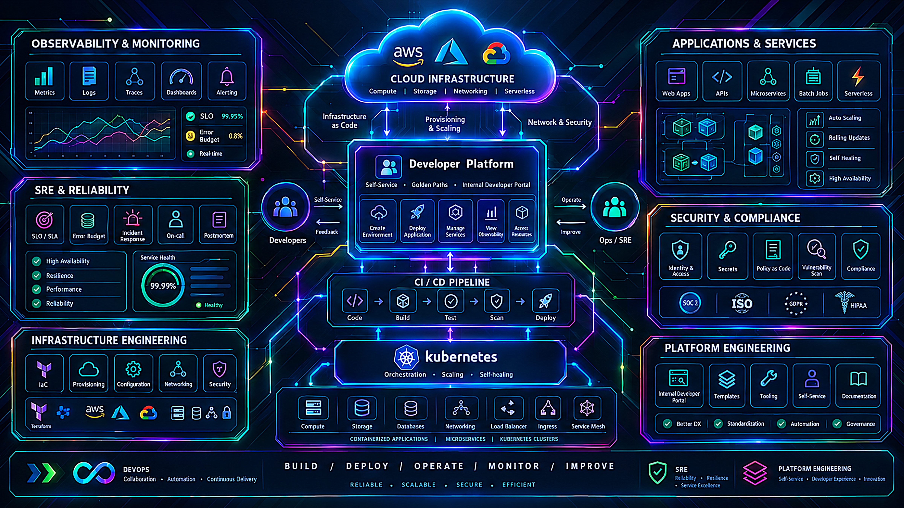

 <picture>
  <source media="(prefers-color-scheme: dark)" srcset="./ID Banner Dark Version.gif">
  <source media="(prefers-color-scheme: light)" srcset="./ID Banner Light Version.gif">
  
</picture>

<h1 align="center">Hi, I'm MD Shohan 👋</h1>

<h3 align="center">Computer Science & Engineering Student | Cloud & DevOps Enthusiast</h3>

  <a href="https://www.md-shohan.com">Portfolio</a> •
  <a href="https://github.com/MD-SH0HAN">GitHub</a> •
  <a href="mailto:mohammad.and.shohan@gmail.com">Email</a>

---

## 👨‍💻 About Me

I'm **MD Shohan**, a Computer Science & Engineering student at Bangladesh University with a strong interest in **Cloud Computing, DevOps, and Infrastructure Automation**.

I'm building my engineering foundation through hands-on experimentation, practical projects, and continuous learning. My goal is to understand how modern applications are built, deployed, secured, and operated reliably.

- 🎓 Studying Computer Science & Engineering
- ☁️ Exploring cloud infrastructure and automation
- 🐧 Developing my Linux and command-line skills
- 📦 Learning containerization and orchestration
- ⚙️ Exploring CI/CD pipelines and Infrastructure as Code
- 🎯 Working toward building reproducible, secure, and maintainable systems

I believe in learning by building, documenting what I learn, and improving through experimentation.

## 🧭 Current Learning Roadmap

| Area | Current Focus |
|---|---|
| Linux & Systems | Linux fundamentals, Ubuntu, shell workflows, and system administration |
| Cloud Computing | AWS fundamentals, cloud services, and infrastructure concepts |
| Infrastructure as Code | Terraform and Ansible |
| Containers | Docker, Docker Compose, and container image management |
| Orchestration | Kubernetes, Helm, `kubectl`, and local Kubernetes environments |
| CI/CD | GitHub Actions, automated testing, and deployment workflows |
| Networking & Security | NGINX, SSH, TLS/HTTPS, and secure configuration |

*This roadmap reflects my learning interests, not a claim of professional mastery in every technology.*

## 🛠️ Technologies & Tools

  <strong>Operating Systems & Development</strong> 
  
  
  
  
  
  

  <strong>Cloud & Infrastructure</strong> 
  
  
  

  <strong>Containers & Orchestration</strong> 
  
  
  
  
  
  

  <strong>Automation, Networking & Storage</strong> 
  
  
  
  
  
  

## 🏗️ DevOps Engineering Architecture

This diagram represents the broader engineering ecosystem I'm exploring, including cloud infrastructure, automation, container orchestration, networking, monitoring, and security.

  

## 🚀 Projects & Practical Work

I use hands-on projects to turn concepts into practical engineering experience. My focus is on understanding how systems work, documenting implementation decisions, and making projects reproducible.

**Projects will be featured here as I publish and document them.**

<!--
Add a project when its repository is ready.

### Project Name
A concise description of the problem, solution, and technologies used.

- **Technologies:** List the tools actually used
- **Highlights:** Explain the main implementation details
- **Verification:** Describe tests or a working demonstration
- **Repository:** Link to the project
-->

## 🎯 Current Focus

- Strengthening Linux fundamentals and system administration
- Building containerized applications with Docker
- Practicing Kubernetes deployment and service management
- Learning to provision infrastructure with Terraform
- Automating builds and tests with GitHub Actions
- Developing projects with clear documentation and reproducible setup instructions

## 🤝 Connect With Me

I'm happy to connect with fellow learners, developers, and people interested in Cloud Computing, DevOps, and infrastructure engineering.

  
  
  

  <a href="https://www.facebook.com/mohammad.and.shohan">Facebook</a> •
  <a href="https://www.instagram.com/_md.shohan_/">Instagram</a> •
  <a href="https://www.threads.com/@_md.shohan_">Threads</a> •
  <a href="https://www.twitch.tv/md_shohan">Twitch</a> •
  <a href="https://www.tumblr.com/md-shohan">Tumblr</a> •
  <a href="https://www.reddit.com/user/MD-SH0HAN/">Reddit</a>

---

  <i>Learning with purpose. Building through practice. Improving continuously.</i>

