  <picture>
    <source media="(prefers-color-scheme: dark)" srcset="Dark%20Header.svg" />
    <source media="(prefers-color-scheme: light)" srcset="Light%20Header.svg" />
    
  </picture>

  <strong>PLATFORM ENGINEERING · INTERNAL DEVELOPER PLATFORMS · CLOUD-NATIVE AUTOMATION</strong>

  <a href="#my-platform-engineering-direction">⚙️ Platform Engineering</a> &nbsp;·&nbsp;
  <a href="#technology-toolkit">🛠️ Technology Toolkit</a> &nbsp;·&nbsp;
  <a href="#learning-roadmap">🗺️ Learning Roadmap</a> &nbsp;·&nbsp;
  <a href="#planned-labs--projects">🧪 Labs &amp; Projects</a> &nbsp;·&nbsp;
  <a href="#learning-resources">📚 Learning Resources</a>

---

## About Me

I'm **MD Shohan**, a **Computer Science & Engineering student at Bangladesh University** building a foundation in **Platform Engineering** through cloud-native infrastructure, automation, and hands-on technical labs.

I'm interested in making software delivery simpler and more reliable by turning repeatable engineering tasks into **documented, automated, secure, and self-service workflows**. My current foundation includes Linux, AWS fundamentals, Infrastructure as Code, containers, Kubernetes, and CI/CD. I'm growing these skills toward internal developer platforms and developer-focused engineering experiences.

- 🎓 Computer Science & Engineering student
- 🧱 Learning to build repeatable infrastructure and deployment workflows
- ☸️ Practicing container and Kubernetes fundamentals
- ⚙️ Exploring automation, platform interfaces, and developer self-service
- 📚 Documenting labs with setup steps, validation, troubleshooting, and cleanup instructions

> **My approach:** understand the problem, build a reproducible solution, validate it, document it, and improve it from feedback.

## My Platform Engineering Direction

Platform Engineering is more than a collection of tools. It combines **people, processes, policies, and technology** to provide software teams with a reliable internal platform. The platform is treated as a product: developers are its users, their workflows shape its design, and feedback helps guide improvements.

My goal is to learn how to connect infrastructure, delivery automation, secure defaults, documentation, and operational visibility into **golden paths** that help developers build, test, deploy, and operate services with less avoidable complexity. An **internal developer platform (IDP)** is the underlying set of capabilities and workflows; a developer portal such as Backstage can provide a useful interface to those capabilities, but the portal alone is not the whole platform.

### Principles I Want to Build Around

| Principle | What it means in practice |
|---|---|
| **Platform as a Product** | Understand developer needs, collect feedback, improve the experience, and prioritize useful capabilities. |
| **Self-Service by Default** | Let developers complete common tasks without waiting for manual platform-team intervention. |
| **Golden Paths, Not Golden Cages** | Provide a well-supported recommended route while allowing documented, controlled exceptions when needed. |
| **Secure and Governed Defaults** | Build in least-privilege access, safe configuration, policy checks, and responsible resource usage. |
| **Automation with Clear Feedback** | Make workflows repeatable and show meaningful status, logs, errors, and next steps. |
| **Measure Outcomes** | Evaluate usability, adoption, delivery flow, reliability, and developer feedback—not just the number of tools deployed. |

### Platform Capability Map

This map describes the areas I'm learning toward. It is a learning direction, **not a claim that I have already implemented a production internal developer platform**.

| Platform Area | Key Topics | Current Direction |
|---|---|---|
| **Infrastructure Foundations** | Linux, networking, cloud resources, Infrastructure as Code | Build on AWS fundamentals, Terraform, and Ansible. |
| **Workload Platform** | Containers, Kubernetes, Helm, registries, workload configuration | Practice with Docker, kind, Kubernetes, Helm, and GHCR. |
| **Golden Paths & CI/CD** | Reusable pipelines, app templates, build/test/release workflows | Use GitHub Actions as a foundation for repeatable delivery. |
| **Internal Developer Portal** | Service catalog, software templates, documentation, ownership | Learn the concepts and explore [Backstage](https://backstage.io/docs/). |
| **GitOps & Release Management** | Declarative delivery, reconciliation, rollbacks, environment promotion | Explore GitOps workflows and tools such as [Argo CD](https://argo-cd.readthedocs.io/) or [Flux](https://fluxcd.io/docs/). |
| **Security & Governance** | Identity and access, secrets, policy as code, image and dependency checks | Strengthen secure configuration and learn policy and supply-chain controls. |
| **Observability & Reliability** | Logs, metrics, traces, alerts, SLIs/SLOs, incident learning | Explore [OpenTelemetry](https://opentelemetry.io/docs/), [Prometheus](https://prometheus.io/docs/), and [Grafana](https://grafana.com/docs/). |
| **Developer Experience** | Discoverability, onboarding, task success, documentation, feedback | Learn to reduce friction and evaluate the platform from a developer's perspective. |
| **Cost & Resource Governance** | Ownership, tagging, budgets, capacity, efficient defaults | Consider cost and resource visibility as part of platform design. |

## Technology Toolkit

The badges below reflect tools already listed in my learning and practice areas. **They do not imply equal proficiency or production experience with every tool.** Additional platform-engineering technologies are listed in the roadmap as topics to explore.

### Systems & Collaboration

  
  
  
  
  
  

### Cloud & Infrastructure as Code

  
  
  

### Containers & Kubernetes

  
  
  
  
  
  

### Delivery, Networking & Service Configuration

  
  
  
  
  

## Learning Roadmap

My roadmap moves from reliable foundations toward a small, useful developer platform rather than trying to adopt every tool at once.

1. **Strengthen the foundations** — Linux, Git, networking, DNS, TLS, containers, cloud fundamentals, and repeatable infrastructure with Terraform and Ansible.
2. **Standardize software delivery** — build CI workflows for validation, testing, image creation, artifact publishing, and deployment checks.
3. **Develop Kubernetes operating skills** — deployments, services, ingress, configuration, secrets, resource requests and limits, RBAC, health checks, and rollbacks.
4. **Create a first golden path** — a starter-service workflow with documented defaults, reusable CI, container packaging, a deployment route, and troubleshooting guidance.
5. **Explore the developer platform layer** — Backstage concepts, service catalogs, software templates, documentation-as-code, and self-service interfaces.
6. **Add platform guardrails and visibility** — policy as code, supply-chain checks, GitOps, logs/metrics/traces, alerting, and basic SLO thinking.
7. **Improve from evidence** — use developer feedback, onboarding friction, task success, adoption, delivery performance, reliability, and cost signals to decide what to improve next.

## Planned Labs & Projects

These are **planned learning projects**, not completed-project claims. I plan to publish each repository with setup instructions, architecture notes, validation steps, troubleshooting, and cleanup guidance.

### 1. Golden-Path Service Starter

A small application workflow demonstrating how a developer could move from a repository to a validated container image and a repeatable deployment.

- **Planned building blocks:** Docker, GitHub Actions, GHCR, Helm, and a local Kubernetes cluster with kind.
- **Platform concepts:** reusable workflow, sensible defaults, documented configuration, validation, and clear failure feedback.
- **Success criteria:** another person can follow the instructions and reproduce the workflow.

### 2. Reproducible Infrastructure Baseline

A small, documented infrastructure lab focused on repeatability and safe operations.

- **Planned building blocks:** Terraform, AWS fundamentals, and Ansible where configuration management is useful.
- **Platform concepts:** explicit inputs, reusable configuration, access boundaries, state awareness, and a documented cleanup process.
- **Success criteria:** provisioning and cleanup steps are repeatable and risks are explained.

### 3. Internal Developer Portal Prototype

A learning prototype that demonstrates how developers can discover services and start from a consistent template.

- **Planned building blocks:** Backstage software catalog, software templates, and TechDocs.
- **Platform concepts:** service ownership, discoverability, a golden-path starter, and docs close to the code.
- **Success criteria:** a user can find a sample service, understand who owns it, and follow the documented starter workflow.

### 4. Platform Observability & Guardrails Lab

A small example of adding operational visibility and basic controls to a sample workload.

- **Planned learning areas:** metrics, logs, traces, health checks, policy as code, and container-image checks.
- **Possible tools to explore:** OpenTelemetry, Prometheus, Grafana, and a Kubernetes policy engine.
- **Success criteria:** the workload has documented signals, checks, and a clear way to investigate common failures.

## How I Think About Platform Quality

A platform should make the supported path easier to use and safer to operate. When I start evaluating my labs, I want to look beyond whether the deployment works once.

| Signal | Question it helps answer |
|---|---|
| **Time to first successful deployment** | How quickly can a new user follow the golden path and ship a working change? |
| **Task success & recovery** | Can users finish common workflows and understand what to do when something fails? |
| **Adoption & repeat usage** | Do developers return to the platform because it is useful? |
| **Delivery performance** | How are lead time, deployment frequency, change failures, and recovery time changing? |
| **Developer feedback** | Where do users experience friction, confusion, or unnecessary cognitive load? |
| **Reliability, security & cost** | Are services observable, guarded by sensible controls, and using resources responsibly? |

These are evaluation goals for my learning projects—not results or metrics I claim to have achieved.

## Connect With Me

I'm happy to connect with people working on platform engineering, cloud-native systems, developer experience, automation, and open-source tooling.

  
  &nbsp;
  
  &nbsp;
  
  &nbsp;
  

### Find Me Around the Web

  
  &nbsp;&nbsp;&nbsp;
  
  &nbsp;&nbsp;&nbsp;
  
  &nbsp;&nbsp;&nbsp;
  
  &nbsp;&nbsp;&nbsp;
  
  &nbsp;&nbsp;&nbsp;
  
  &nbsp;&nbsp;&nbsp;
  
  &nbsp;&nbsp;&nbsp;
  
  &nbsp;&nbsp;&nbsp;
  
  &nbsp;&nbsp;&nbsp;
  

## GitHub Contribution Activity

  <picture>
    <source media="(prefers-color-scheme: dark)" srcset="https://raw.githubusercontent.com/MD-SH0HAN/MD-SH0HAN/output/github-contribution-grid-snake-dark.svg" />
    <source media="(prefers-color-scheme: light)" srcset="https://raw.githubusercontent.com/MD-SH0HAN/MD-SH0HAN/output/github-contribution-grid-snake.svg" />
    
  </picture>

## GitHub Activity

  <picture>
    <source media="(prefers-color-scheme: dark)" srcset="./profile/stats-dark.svg" />
    <source media="(prefers-color-scheme: light)" srcset="./profile/stats-light.svg" />
    
  </picture>
  <picture>
    <source media="(prefers-color-scheme: dark)" srcset="./profile/top-langs-dark.svg" />
    <source media="(prefers-color-scheme: light)" srcset="./profile/top-langs-light.svg" />
    
  </picture>

  <em>Learn deliberately. Build reproducibly. Make developers more effective.</em>

